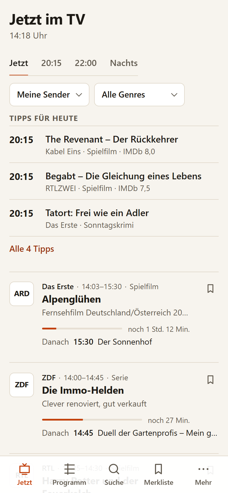
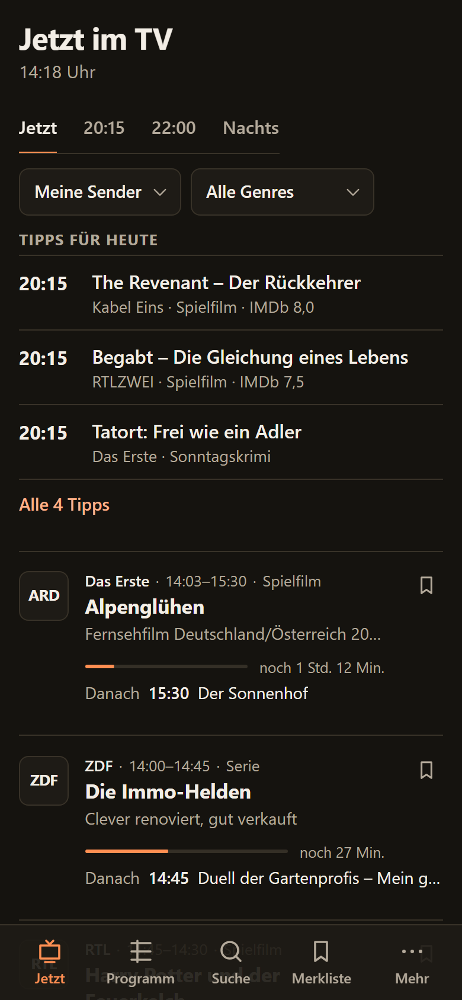
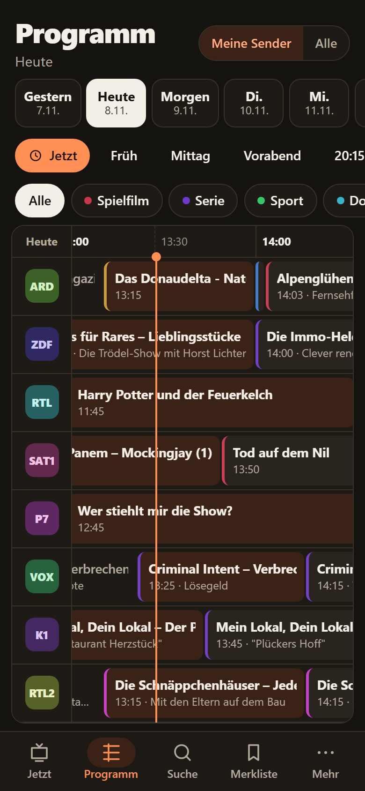
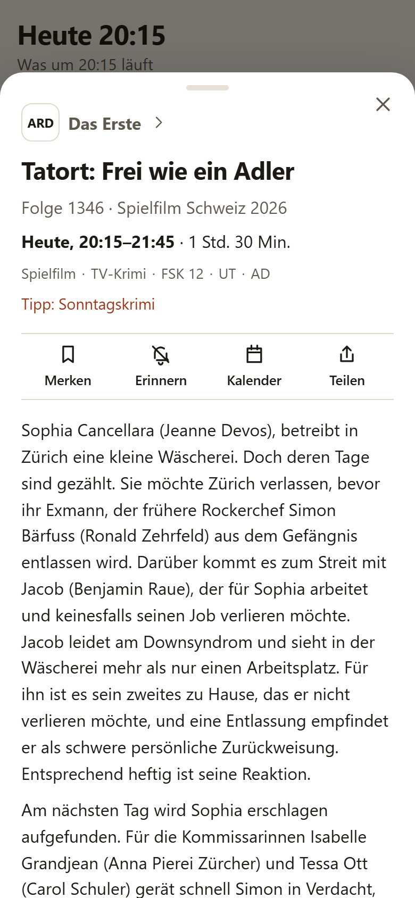
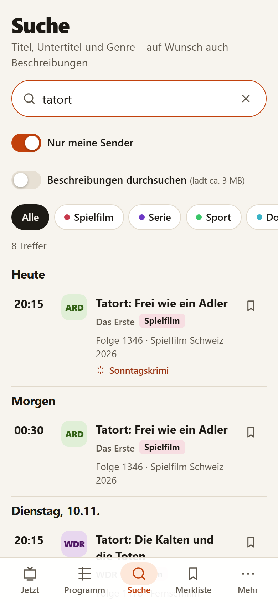
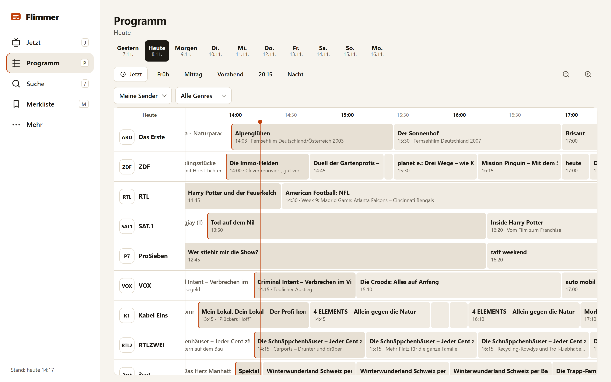
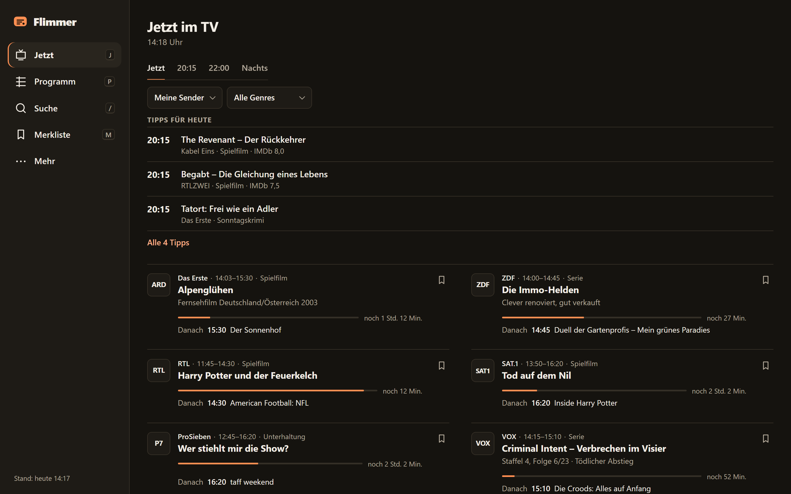

<p align="center">
  
</p>

<h1 align="center">Flimmer</h1>
<p align="center"><strong>Das deutsche TV-Programm. Aufgeräumt.</strong><br>
Werbefrei · ohne Tracking · offline nutzbar · installierbar</p>

<p align="center">
  
  
  
  
  
</p>

---

> ℹ️ **Betreiberangaben** (Name, Anschrift, E-Mail, Aufsichtsbehörde) stehen zentral in [`app.config.ts`](app.config.ts) und erscheinen in Impressum, Datenschutzerklärung und Kontakt. Werte in `[ECKIGEN KLAMMERN]` gelten als Platzhalter und lösen in der App einen Warnhinweis aus. Die Rechtstexte sind sorgfältig erstellt, **ersetzen aber keine Rechtsberatung**.

Flimmer öffnet sich und zeigt sofort, **was jetzt läuft** und **was heute um 20:15 kommt** – in zwei Sekunden checkbar. Keine Werbung, keine Klickstrecken, keine Konten, keine Cookies.

## Screenshots

| Jetzt (hell) | Jetzt (dunkel) | Raster (dunkel) | Details | Suche |
|---|---|---|---|---|
|  |  |  |  |  |




## Funktionen

- **Jetzt im TV** mit Fortschrittsbalken, Restzeit und „Danach“ – plus Schnellwahl **20:15**, **22:00**, **Nachts**
- **Tipps des Tages** nach nachvollziehbaren Regeln (z. B. „Spielfilm · IMDb 7,6“, „Live-Sport“) – Grund steht immer dabei
- **Programmraster** Sender × Zeit mit Tagesauswahl (bis zu 10 Tage), „Jetzt“-Linie, Sprungmarken, Zoom, Genre-Hervorhebung und voller **Tastatursteuerung**
- **Sendertag**: komplettes Tagesprogramm eines Senders
- **Meine Sender**: Favoriten, Reihenfolge per **Ziehen oder Pfeil-Buttons**, Sender ausblenden
- **Suche** client-seitig, offline, **fehlertolerant** („tatrot“ → Tatort), optional in Beschreibungen
- **Genre-Filter**: Spielfilm, Serie, Sport, Doku, Nachrichten, Kinder, Unterhaltung, Magazin, Musik
- **Details**: Beschreibung, Zeit, Dauer, Genre, Staffel/Folge, Jahr, Land, FSK, Wiederholung, Live/Neu, UT/AD/DGS, Regie/Besetzung, Regionalfenster, **weitere Termine**
- **Merkliste** mit **Erinnerungen**, **Kalender-Export (.ics)** einzeln oder gesammelt, **Teilen** (Web Share API mit Fallback)
- **Einstellungen**: Hell/Dunkel/System, 4 Schriftgrößen, 24-h/12-h, Startansicht, Erinnerungsvorlauf, **Export/Import**, Daten löschen
- **Onboarding** mit Senderauswahl (überspringbar, wiederholbar)
- **PWA**: installierbar, offline, App-Shortcuts („Jetzt“, „20:15“, „Suche“), Update-Hinweis, iOS-Hinweise
- **Seiten**: Impressum, Datenschutz, Datenquellen & Lizenzen, Über/Changelog, Hilfe/FAQ, Feedback
- **Tastaturkürzel**: `J` Jetzt · `P` Programm · `/` Suche · `M` Merkliste · `E` Einstellungen · `N` zu jetzt · `Alt+←/→` Tag · `?` Hilfe

## Architektur

```mermaid
flowchart LR
  ARD[ARD-Programm-API] --> JOB
  XML[XMLTV epgshare01] --> JOB
  PREV[Letzter Live-Stand] -. Fallback .-> JOB
  subgraph GitHub Actions – alle 6 h
    JOB[Daten-Job<br/>pipeline/run.ts] --> BUILD[Vite-Build<br/>+ Service Worker]
  end
  BUILD --> CF[(Cloudflare Pages<br/>statische Dateien)]
  CF --> SW[Service Worker] --> APP[Preact-App]
  APP <--> LS[(localStorage)]
```

**Datenfluss:** Der Job lädt beide Quellen, bereinigt (Überlappungen, Lücken, Regionalfenster, Genres, Zeitzonen), führt zusammen, berechnet Tipps und schreibt `data/index.json`, `data/days/<TV-Tag>.json` (~60 KB gz) und `data/details/<TV-Tag>.json`. Die App lädt nur benötigte Tage und cacht sie für offline. Details: [docs/ARCHITECTURE.md](docs/ARCHITECTURE.md).

## Lokale Entwicklung

Voraussetzung: Node.js ≥ 22.

```bash
npm install
```

```bash
npm run data
```

```bash
npm run dev
```

Weitere Befehle:

| Befehl | Zweck |
|---|---|
| `npm run data` | Echte Programmdaten nach `public/data` holen |
| `npx tsx scripts/fixture-data.ts` | Testdaten erzeugen (ohne Netz) |
| `npm run check` | Lint + Typecheck + Unit-Tests + Build |
| `npm run test:e2e` | Playwright gegen `npm run preview` (vorher `npm run build`) |
| `npm run icons` | PNG-Icons aus SVG erzeugen |
| `npm run screenshots` | README-/Manifest-Screenshots (Preview muss laufen) |

## Deployment (kostenlos)

1. **Cloudflare-Konto** anlegen (Free, keine Kreditkarte) → *Workers & Pages* → *Create* → *Pages* → *Direct Upload* → Projektname `flimmer` (einmalig mit beliebigem Ordner anlegen, oder erster Workflow-Lauf erstellt es).
2. **API-Token** erstellen: *My Profile → API Tokens → Create Token → „Cloudflare Pages – Edit“*. **Account-ID** steht in der Dashboard-Seitenleiste.
3. Im GitHub-Repo unter *Settings → Secrets and variables → Actions*:
   - Secret `CLOUDFLARE_API_TOKEN`, Secret `CLOUDFLARE_ACCOUNT_ID`
   - Variable `SITE_URL` = `https://flimmer.pages.dev` (bzw. eigene Domain) – für den Fallback auf den letzten guten Stand
   - optional Variable `CF_PAGES_PROJECT`, falls der Projektname nicht `flimmer` ist
4. Workflow **„Daten aktualisieren & veröffentlichen“** manuell starten (*Actions → Run workflow*). Danach läuft er alle 6 Stunden und bei jedem Push auf `main`.
5. Optional eigene Domain in Cloudflare Pages verbinden.

Fehlschläge des Daten-Jobs (Quelle gestört, zu wenige Sender) meldet GitHub per E-Mail; die Seite bleibt mit dem letzten guten Stand online.

**Kosten-/Limit-Übersicht:** GitHub Actions privat 2.000 min/Monat (Verbrauch ≈ 250–400 min) · Cloudflare Pages Free: unbegrenzte Bandbreite, 500 Builds/Monat (Verbrauch ≈ 130), 20.000 Dateien (≈ 30). Begründung in [docs/DECISIONS.md](docs/DECISIONS.md).

## Datenquellen & Rechtliches

- **ARD-Programm-API** für Das Erste, Dritte, ONE, alpha, tagesschau24, 3sat, arte, KiKA, phoenix (~8 Tage).
- **XMLTV-Sammlung von epgshare01** für ZDF-Familie, Private, Sport, Kinder u. a. (~3–4 Tage) und zur Anreicherung.
- Keine Senderlogos, keine Sendungsbilder, gekürzte Fremdbeschreibungen, Quellenangabe in der App.
- **Restrisiko:** Die XMLTV-Daten stammen ursprünglich von Programmzeitschriften. Für ein privates, werbefreies Projekt vertretbar, für kommerzielle Nutzung nicht. Details und Ausstiegsoption: [docs/DATA_SOURCES.md](docs/DATA_SOURCES.md).
- Datenschutz: keine Cookies, kein Tracking, keine Drittanbieter-Requests; Einstellungen nur im Browser.

## Roadmap

- [ ] Eigene Domain + Cloudflare verbinden
- [ ] Weitere Sender auf Wunsch (Konfiguration in `pipeline/channels.ts`)
- [ ] „Serie beobachten“: neue Termine eines Titels automatisch auf die Merkliste
- [ ] Abonnierbarer Kalender-Feed (statische `.ics` je Merkliste via Share-Link)
- [ ] Optional: Web-Push über Cloudflare Workers (Free) für Erinnerungen bei geschlossener App
- [ ] Lizenzierte Datenquelle für Privatsender, falls verfügbar

## Lizenz

Code: [MIT](LICENSE). Programmdaten: Rechte bei den jeweiligen Sendern/Quellen.
