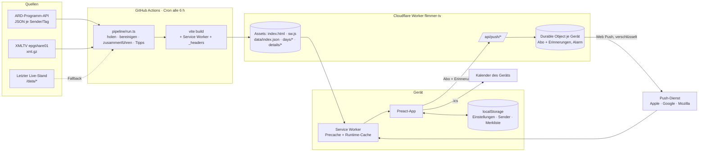

# Architektur



## Verzeichnisse

```
pipeline/        Daten-Job (Node/TS): Quellen, Normalisierung, Ausgabe
worker/          Cloudflare Worker: Push-API, Durable Object, Web-Push-Krypto
src/shared/      Von Job und App gemeinsam genutzt: Typen, Zeitlogik, Genres
src/app/         App: store/ (Signals), views/, components/, lib/ (Suche, ICS, Erinnerungen)
app.config.ts    Betreiberangaben (Platzhalter!) für Impressum/Datenschutz
public/          Icons, robots.txt, sw-extra.js, (data/ wird generiert)
scripts/         Icons, Screenshots, Testdaten
tests/unit       Vitest (Zeit, Pipeline, Suche, ICS)
tests/e2e        Playwright (Mobile + Desktop, Offline, PWA)
```

## Datenfluss in der App

1. `index.json` (NetworkFirst, 4 s Timeout → Cache) liefert Sender und verfügbare Tage.
2. Ansicht lädt nur die benötigten TV-Tage (`days/<tag>.json`, ~60 KB gz). Morgen wird im Leerlauf vorgeladen.
3. Details (Beschreibung, Besetzung) erst beim Öffnen einer Sendung (`details/<tag>.json`, StaleWhileRevalidate).
4. Sendungs-ID = `<sender>-<start>` → aus der ID ergibt sich die Tagesdatei; Detail-Links sind dadurch teilbar.

## Zeit

Alle fachlichen Berechnungen in `Europe/Berlin` über `Intl` (DST-sicher, unabhängig von der Gerätezeitzone). TV-Tag 05:00–05:00; Sendungen über 05:00 stehen in beiden Tagesdateien. Tests decken 23-/25-Stunden-Tage ab.

## Service Worker & Updates

- Workbox `generateSW`, `registerType: prompt`: Neue Version → Hinweis „Neue Version verfügbar · Aktualisieren“ (kein ungefragtes Neuladen). Prüfung stündlich und beim Zurückkehren in die App.
- `clientsClaim` bei Erstinstallation + Cache-Aufwärmen → schon der erste Besuch ist offline-fähig.
- `ignoreVary` für Datencaches (Preload-Requests tragen andere Header).

## Performance

- ~40 KB JS + 8 KB CSS (gzip), keine Webfonts, keine Bilder außer Icons.
- Programmraster rendert horizontal nur das sichtbare Zeitfenster ± 2 h; Listen nutzen `content-visibility`.
- Lighthouse (Mobile, Produktions-Build, 08.11.2026): Jetzt 99/100/100/100, Raster 98/100/100/100, Suche 96/100/100/100, Dark 98/100/100/100; Desktop-Raster 100/100/100/100.

## Barrierefreiheit

Semantische Landmarks, Skip-Link, Fokus auf Seitenüberschrift bei Navigation, `<dialog>` mit Fokusfalle und Esc, Raster als ARIA-Grid mit Roving-Tabindex und Pfeiltasten, Live-Region für Suchtreffer, Touch-Ziele ≥ 44 px, Kontraste AA (hell und dunkel geprüft), `prefers-reduced-motion`, skalierbare Schrift (4 Stufen).
